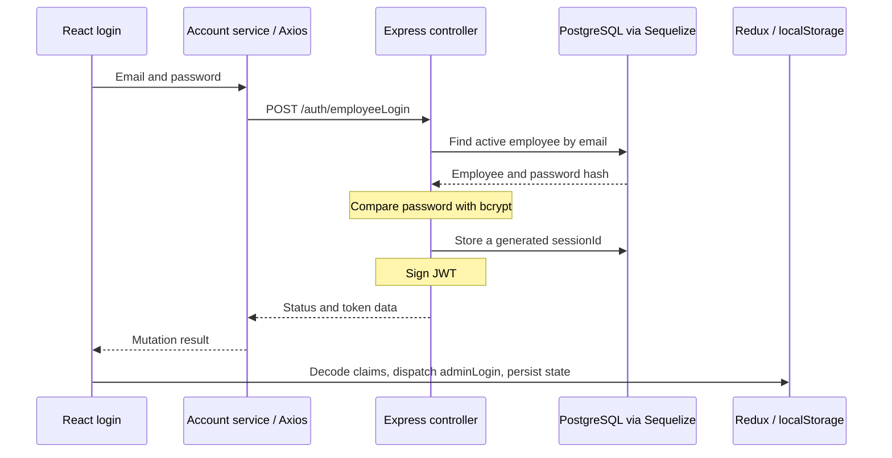

# HRMS — Phase 1 learning notes: database setup and login

These notes describe what we built, what you demonstrated, and what to learn next. They are a study reference, not instructions to rerun setup against an existing database. Current phase: November 3, 2026.

## 1. What you achieved

You connected an Express/TypeScript backend to PostgreSQL, created an employee table through a Sequelize migration, inserted a test employee through a seeder, and logged in from React.

| Milestone | Evidence/status |
|---|---|
| Backend starts on port 9000 and connects to PostgreSQL | You reported successful startup |
| CLI reads the database configuration | You ran migration status successfully |
| Employee table created | Migration reported `migrated` |
| Test employee inserted | Seeder reported `migrated` |
| Correct credentials return a token through the frontend | You confirmed |
| Incorrect password is rejected | You confirmed the behavior; exact HTTP status was not separately captured |
| Unknown email is rejected as expected | Suggested, but not confirmed yet |
| Reload, expiry, logout, protected APIs, permissions | Not verified as complete |

These were manual development checks. They are useful evidence, but they are not an automated test suite or proof that the entire authentication lifecycle is finished.

## 2. The three flows to remember

### Database structure

```text
You run db:migrate
    → CLI reads .sequelizerc and sequelize-cli.cjs
    → Migration up() runs
    → PostgreSQL creates employees
    → SequelizeMeta records the migration filename
```

### First employee

```text
You run a specific seeder
    → bcrypt hashes the test password
    → bulkInsert inserts a row into employees
    → A user now exists who can log in
```

The first employee does not need to be created through an authenticated API. Once an authorized employee exists, an employee-creation API can handle normal application use.

### Login request



This diagram follows your current implementation. Backend token verification on later requests is still a separate task.

## 3. Model, migration, seeder, API

| Piece | Responsibility | Example in this project |
|---|---|---|
| Model | Current application mapping and behavior for employee records | `src/model/employee.model.ts` |
| Migration | An explicit change to the database structure | `src/migrations/20261103201527-create-employees.cjs` |
| Seeder | Initial, reference, or test records | `src/seeders/20261103203916-test-employee.cjs` |
| API route/controller | Handles an HTTP request using application logic | `POST /auth/employeeLogin` |

Creating an employee table and creating an employee are different operations. The first creates structure; the second inserts a row.

The model does not send its definition to a migration. In this project they run independently. Updating the model alone does not update PostgreSQL. For a future field, update the model and write a new migration to alter the existing table.

`Employees.sync()` is another mechanism that can create a table from a model. We chose migrations to follow the original project's tracked schema-change workflow.

In the model, `DataTypes.STRING` comes from an import. In a migration, the CLI supplies the `Sequelize` argument, and `Sequelize.STRING` exposes the corresponding type. The naming difference does not explain their different responsibilities.

### Reading your column definitions

| Definition | Meaning |
|---|---|
| `UUID` | Identifier type; it does not grant permission or hide a record |
| `STRING` | Variable-length text |
| `DATEONLY` | Calendar date, such as date of joining |
| `DATE` | Timestamp, such as `createdAt` |
| `BOOLEAN` | True/false value |
| `ENUM(...)` | Restricts values to a defined set |
| `allowNull: false` | A value cannot be SQL NULL; it can still need format/nonempty validation |
| `primaryKey: true` | Identifies a row uniquely |
| `unique: true` | Database rejects duplicate non-null values for this column |
| `defaultValue` | Supplies a value when an insert omits the field |

Your model expects `createdAt` and `updatedAt` because Sequelize timestamps are enabled by default. Your migration explicitly created those columns. Raw inserts must provide them unless database defaults exist.

Your model can generate UUIDs in the application. The migration also defines PostgreSQL's `gen_random_uuid()` as a database default, which supports inserts outside the model.

### Apply versus undo

Migration `up()` creates the table. Its `down()` drops the table and cleans up the PostgreSQL gender ENUM type. Dropping the table deletes its records. Recreating it does not recover those records: rollback is not a backup.

The seeder's `up()` inserts the test employee. Its `down()` deletes only that employee, using the known ID and email. An unrestricted deletion would remove unrelated employees too.

Applied migrations are tracked in `SequelizeMeta`. Seed execution history is not tracked by default. Your current seeder is not safe to rerun unchanged: the same ID/email would conflict. Generating a fresh UUID alone would still conflict with the unique email.

Use future migrations for changes to an already shared/applied schema rather than rewriting its history. Reference: [Sequelize migrations and seeders](https://sequelize.org/docs/v6/other-topics/migrations/).

## 4. Configuration and command reference

| File | Purpose |
|---|---|
| `server.ts` | Creates Express, registers middleware/routes, starts listening |
| `config/database.ts` | Creates the application's Sequelize connection using `DATABASE_URL` |
| `.sequelizerc` | Tells the CLI where configuration, migrations, and seeders live |
| `config/sequelize-cli.cjs` | Tells the CLI how to connect using the same `DATABASE_URL` |
| `.env` | Supplies local environment values; not a place for committed credentials |

`use_env_variable: "DATABASE_URL"` names the variable to read. It is not the connection string itself.

Your application uses ES modules (`import` / `export`). The generated CLI files use CommonJS (`require` / `module.exports`). We used `.cjs` to make their format explicit inside a `"type": "module"` package. This does not require converting the rest of your backend.

Commands below are a reference. Run from `hrms-backend`; do not rerun mutations just to revise these notes.

| Command | Effect |
|---|---|
| `npm run dev` | Starts the backend development watcher |
| `npx sequelize-cli db:migrate:status` | Lists migration status; may initialize migration metadata |
| `npx sequelize-cli migration:generate --name create-employees` | Generates a template file |
| `npx sequelize-cli db:migrate` | Applies pending migrations |
| `npx sequelize-cli db:migrate:undo` | Runs the latest applied migration's `down()`; ours deletes the table |
| `npx sequelize-cli seed:generate --name test-employee` | Generates a seed template |
| `npx sequelize-cli db:seed --seed 20261103203916-test-employee.cjs` | Inserts our test employee |

Generating a file does not execute its database changes. A successful connection only proves access to the database; it does not prove that tables or employees exist.

## 5. Passwords, JWTs, and permissions

### Password verification

We store a password hash, not the original password:

```js
const hashedPassword = await bcrypt.hash("Test@123", 12);
const matches = await bcrypt.compare(submittedPassword, hashedPassword);
```

The seeder uses the first operation. Your current controller uses synchronous comparison; the asynchronous example illustrates a later improvement.

Bcrypt includes a random salt and a work factor. Two hashes of the same password can differ and still verify. Cost 12 controls computational effort; it is not an encryption key. We do not decrypt the stored password.

The employee model has a setter that hashes passwords during model writes. `queryInterface.bulkInsert()` bypasses it, which is why the seeder explicitly hashes once. Passing a pre-hashed value through that setter would hash it again and break the expected comparison.

Synchronous bcrypt operations block the Node.js event loop while doing expensive work. Prefer asynchronous APIs in request handlers as the application grows. Reference: [bcrypt usage and async guidance](https://github.com/kelektiv/node.bcrypt.js).

### JWT basics

Your backend signs a JWT containing employee details, a session ID, and expiration information. The signing secret belongs on the backend.

- Decoding reads claims; the frontend does this to obtain display/state information.
- Verification checks the signature and relevant claims, including expiration, on the backend.
- A signed JWT payload is readable; signing does not encrypt its contents.
- A numeric `expiresIn` in `jsonwebtoken` is measured in seconds. Validate the configured value and secret at startup.

A token is useful only when subsequent protected requests are checked. Saving `sessionId` in the database does not automatically invalidate older tokens. Verification must compare it if you want that behavior. Reference: [jsonwebtoken documentation](https://github.com/auth0/node-jsonwebtoken#readme).

Authentication means establishing identity. Authorization means checking allowed actions and records: an employee viewing their own attendance differs from HR viewing everyone's attendance. Menu visibility is a frontend convenience; the backend must enforce access.

For later hardening, unknown users and incorrect passwords should have a consistent external failure response to avoid revealing registered accounts. Your current controller distinguishes 404 and 401; that is current behavior, not the recommended finished design. Reference: [OWASP authentication guidance](https://cheatsheetseries.owasp.org/cheatsheets/Authentication_Cheat_Sheet.html).

## 6. Frontend state and middleware

| Tool | Its job |
|---|---|
| Formik | Form values, validation, submission |
| TanStack Query mutation | Tracks the login request lifecycle |
| Account service | Names the endpoint and request/response types |
| Axios interceptor | Shared HTTP request/response behavior |
| Redux | Shared application state in browser memory |
| localStorage | Saved browser data across reloads |
| React Router | Chooses pages/layouts and lazy-loads route code |

Do not confuse TypeScript response types with runtime validation. A server can send malformed JSON even if the client has an interface.

### Redux lifecycle

```text
dispatch(adminLogin(data))
    → Redux middleware
    → Auth reducer updates UserData
    → Subscribers run, including saveStorage()
    → UI reads the updated state
```

`configureStore` creates the store. The reducer key `UserData` determines the state property. `preloadedState` supplies restored startup data. `Provider` makes the store available to React hooks. The subscription saves state after dispatches; it does not call the login API.

Middleware receives `store`, `next`, and `action`. Calling `next(action)` forwards processing. Redux middleware wraps actions; it is not the same pipeline as HTTP interception or server middleware. Reference: [configureStore](https://redux.js.org/toolkit/api/configureStore).

### Three different processing pipelines

| Pipeline | Example use |
|---|---|
| Redux middleware | Observe actions; synchronize selected actions between tabs |
| Axios interceptor | Attach an access token; handle an HTTP failure |
| Express middleware | Parse JSON; verify a token before a controller runs |

A rejected Axios response should remain rejected unless recovery is intentional. Returning `undefined` from its error handler can turn rejection into fulfillment, causing an error to reach a mutation's success path. Your interceptor still has this gap. Reference: [Axios interceptors](https://axios-http.com/docs/interceptors).

### Reload and return after two days

Reload clears Redux memory. Your `loadStorage()` restores the saved object through `preloadedState`. LocalStorage does not automatically expire after two days. The backend independently decides whether the restored token is valid. Restoring a token never renews its expiration.

Your AES persistence uses `VITE_CIPHER`. Vite exposes `VITE_*` values to browser code, so this key cannot protect a token from JavaScript running in the app. Treat persisted user data as an untrusted cached copy, and validate authentication server-side. Reference: [Vite environment variables](https://vite.dev/guide/env-and-mode).

Cross-tab synchronization and reload persistence solve different problems. Each tab has its own Redux memory. The state-sync middleware is intended to share actions; it also needs its documented listener setup. Configuring a middleware alone does not prove synchronization works.

Cookie sessions were discussed as an alternative; the current clone uses JWT responses and localStorage persistence. Neither Redux nor a change of frontend library replaces a complete backend session policy.

## 7. Testing and unfinished work

Use expected behavior, actual behavior, and HTTP evidence when describing a test. A toast alone does not prove the promise lifecycle, response status, or stored state is correct.

| Case | Expected outcome / next check |
|---|---|
| Valid credentials | 200, usable token, intended user state |
| Wrong password | Rejected login, no new token or user state |
| Unknown email | Current controller: 404; later use consistent authentication failure |
| Missing email/password | 400; no token |
| Non-string input or malformed body | Controlled validation failure rather than accidental 500 |
| Inactive employee | Login rejected |
| Unavailable backend | Clear retryable error, no false success |
| Expired/tampered token | Protected backend request rejected |
| Reload after login | Session checked; stale data alone does not establish identity |
| Logout | Client state cleared and intended server-side invalidation enforced |

Testing levels:

- Unit: isolate a function, such as validating login input.
- Integration: exercise route/controller/database behavior together in a test environment.
- End-to-end: use the browser through login and a protected action.

Backlog from the current files: replace the hardcoded token header, preserve interceptor rejections, implement backend verification and logout, replace the hardcoded `ProtectedRoute` authentication flag, validate configuration, and align UUID/user response types. Remove employee-record logging and avoid returning raw internal errors. These are follow-up tasks; creating these notes did not fix them.

## 8. System design connections

You already practiced a small client/server design. Build on these ideas before studying distributed systems.

| Concept | Connection to this phase |
|---|---|
| Separation of responsibilities | UI collects input; service sends requests; controller coordinates; database stores records |
| API contract | Frontend/backend agree on paths, field names, UUID types, errors, and token transport |
| Source of truth | Backend/database decide access; Redux/localStorage are client copies |
| Data integrity | Primary keys and unique email constraints protect stored data even if client validation is bypassed |
| Lifecycle design | Login, expiry, renewal if supported, revocation, and logout must fit together |
| Failure handling | Distinguish invalid credentials, unavailable service, and unexpected server failure |
| Performance | Password hashing, database lookup, and network time all contribute to latency |
| Observability | Status codes and safe logs help trace failures without exposing credentials |

Your employee has one `sessionId` field. If verification requires it to match the JWT, another login can replace it and invalidate the previous token. Supporting multiple devices may later call for a separate sessions table. Currently, creating that value alone does not enforce a session policy.

This backend is one application with routes and controllers. Folders do not make it microservices. An Axios service wrapper is also not an API gateway: a gateway is a server-side entry point that routes or mediates requests to services. Neither is needed to prove this first login slice.

## 9. DSA connections: where algorithms become useful

DSA means data structures and algorithms. You do not need to invent an algorithm for every API.

| Structure/concept | HRMS application | Beginner lesson |
|---|---|---|
| Array | List of employees or permissions | A linear search can inspect all n items: O(n) |
| Map | Match permission names to menu definitions | Commonly average O(1) lookup instead of repeatedly scanning a list |
| Set | Deduplicate permission keys | Convenient membership and uniqueness checks |
| Tree | Sidebar with nested child routes | Traversal visits n nodes: O(n) |
| Sorting | Order menus by priority | Comparison sorting commonly targets O(n log n); JS implementation details vary |
| B-tree index | Database lookup by email | A selective indexed lookup has roughly logarithmic search behavior |

PostgreSQL provides B-tree indexes for common ordered/equality searches. Real query time depends on row matches, planning, caching, and I/O; an index is not a guarantee that every query is fast. Reference: [PostgreSQL B-tree indexes](https://www.postgresql.org/docs/current/btree.html).

Bcrypt is a password-hashing algorithm; a Map uses hashing for fast lookup. Sharing the word "hash" does not make their goals or algorithms interchangeable.

Practice later: build a permission Set, map permissions to menu items, and traverse a nested menu. First understand one operation's input/output, then reason about time and memory. Do not equate Big-O with total request latency.

## 10. OOP and clean-code connections

OOP means organizing software around objects and their behavior. You can apply useful design ideas in TypeScript without turning every module into a class.

| Concept | Meaning | HRMS connection |
|---|---|---|
| Object | A value with data and behavior | A Sequelize employee instance |
| Encapsulation | Keep implementation details behind a controlled interface | Password hashing behind a model setter or dedicated function |
| Abstraction | Expose what a caller needs | `accountService.loginUser()` hides HTTP details from the component |
| Inheritance | A class specializes a parent class | Sequelize supports extending `Model`; you currently use `define()` |
| Polymorphism | Different implementations satisfy one interface | Later, a real email sender and a test fake can implement the same contract |
| Composition | Assemble behavior from smaller parts | Express builds a pipeline from middleware and routers |

Single responsibility is useful now: keep password verification, token creation, HTTP formatting, and data access understandable. Your controller currently combines several responsibilities; a service layer can help when complexity justifies it.

Dependency injection means passing a dependency into a unit instead of hard-wiring it. Passing a user repository or password verifier makes isolated testing easier. It is a future refactor, not something this phase already fully implements.

Interfaces describe compile-time shapes; they do not validate an HTTP body at runtime. We have not implemented all SOLID principles simply by using models and folders. Learn abstraction and clear responsibilities first.

## 11. Agile and professional working habits

Agile means delivering useful increments, learning from feedback, and adjusting the plan. It is not just working quickly or holding meetings. We delivered one small path from database setup to frontend login, inspected failures, and refined the work. Reference: [Agile principles](https://agilemanifesto.org/principles.html).

Example user story:

> As an active employee, I want to sign in so I can access my authorized HRMS features.

Acceptance criteria for the next increment:

- Correct credentials establish a session and open an intended protected page.
- Invalid credentials do not establish a session.
- Protected APIs reject missing, invalid, and expired credentials.
- Logout has a documented, tested effect.

Acceptance criteria describe a story's behavior. A Definition of Done describes the shared quality bar, such as reviewed code, passing relevant checks, documented setup, and verified error cases. That distinction supports honest progress reporting. Reference: [Scrum Guide](https://scrumguides.org/scrum-guide).

Habits to repeat on every feature:

1. State the goal and acceptance criteria before coding.
2. Split work into small tasks with dependencies: schema → test data → endpoint → UI → checks.
3. Inspect Git diffs and make coherent commits; keep credentials out of commits and logs.
4. Report bugs with steps, expected result, actual result, and relevant status/error.
5. Record confirmed versus pending cases; a success message does not complete every scenario.
6. Review what confused you and improve the next iteration.

For a solo project, a small To do / In progress / Verified board is enough. Scrum is a specific framework within Agile; you do not need to simulate every Scrum event to learn these habits.

## 12. Interview questions and short answers

1. **Explain your login feature.** The client posts credentials. Express validates them, Sequelize fetches an active employee, bcrypt checks the hash, and the backend signs a JWT. React stores the returned data. Protected-request verification is a separate follow-up.

2. **What is an ORM?** A library that maps application data operations to relational database queries. Sequelize reduces repetitive SQL, but SQL knowledge is still important.

3. **How does a model differ from a migration?** A model describes current application mapping/behavior. A migration records an explicit database structure change.

4. **Does changing a model change the database?** Not automatically in our migration-managed setup. We also need a migration.

5. **Why not create tables on every API call?** Schema setup is a controlled operation. Normal business APIs should work with existing tables and records.

6. **What are up and down?** Apply and reverse a change. Reversing a table creation deletes its rows; it is not data recovery.

7. **What is SequelizeMeta?** The table recording applied migration names so pending changes can be identified.

8. **What is a seeder?** A way to insert initial, reference, or test records, including a first admin. It is not limited to dummy data.

9. **Why hash the password in the seeder?** Raw bulk insertion bypasses our model setter, so we explicitly hash once before insertion.

10. **Why not encrypt passwords?** Password verification needs a one-way password hash. Reversible encryption introduces a recoverable password secret.

11. **Why can hashes of the same password differ?** Bcrypt uses random salts. Its compare function checks a candidate using the stored hash's parameters.

12. **Is a JWT encrypted?** Our signed JWT is not encrypted. Its claims can be decoded; the signature protects integrity when properly verified.

13. **Decode versus verify?** Decode reads claims; verify checks signature and relevant validity conditions. Frontend decoding never authorizes a backend request.

14. **Authentication versus authorization?** Identity versus access to actions and particular records.

15. **Why is CORS not authentication?** CORS controls browser cross-origin access behavior. It does not prove a caller's identity or block every non-browser client.

16. **Redux versus localStorage?** Live shared client memory versus browser persistence. Neither makes an expired token valid.

17. **What does middleware do?** Adds processing around a pipeline. Identify whether you mean Redux actions, HTTP client calls, or Express requests.

18. **Why reject errors from an interceptor?** So the caller can observe failure. Returning normally can make a failed request look fulfilled.

19. **What do common HTTP statuses mean?** 200: success; 400: invalid request; 401: valid authentication missing/failed; 403: access forbidden; 500: unexpected server failure. [HTTP status reference](https://developer.mozilla.org/en-US/docs/Web/HTTP/Reference/Status)

20. **Why enforce unique email in the database?** It prevents duplicates even when requests race or bypass frontend checks.

21. **Can TypeScript validate incoming JSON?** Types alone cannot. Runtime checks must establish shape, types, lengths, and allowed values.

22. **Where is DSA relevant?** Email indexes, permission Sets/Maps, menu trees, and sorting. Avoid a custom data structure until it solves a real need.

23. **Where is OOP relevant?** Models expose data/behavior and services provide abstractions. Classes and inheritance are optional choices, not proof of good design.

24. **What does Agile look like here?** Small usable increments, explicit acceptance criteria, testing, feedback, and honest tracking of remaining work.

25. **How would you add a field to a table with real records?** Plan compatibility, add a new migration, backfill if needed, update application code, and only enforce required constraints once existing records satisfy them.

26. **What have you not completed yet?** Full token verification, protected navigation/APIs, logout/expiry behavior, permissions, and automated coverage. State limitations clearly rather than claiming production readiness.

## 13. What to learn next, without rushing

| Priority | Topic | Small exercise |
|---|---|---|
| Now | SQL basics | Write SELECT, INSERT, UPDATE, DELETE with a WHERE clause in a practice database |
| Now | HTTP and debugging | Inspect status, body, headers, and pending/error UI in browser Network tools |
| Now | Promises and async/await | Explain what rejection, catch, and finally do in one request |
| Next | Input validation and types | Reject missing and non-string login values predictably |
| Next | Authentication middleware | Verify a token before one protected test endpoint |
| Next | Session lifecycle | Test expiry, reload, logout, and failure recovery |
| Later | Permissions and relations | Model roles/permissions and enforce access to a specific employee's records |
| Later | Testing and transactions | Add isolated integration tests; learn atomic changes and rollback |
| Later | Performance | Use EXPLAIN, pagination, async hashing, and measured bottlenecks |

Repeat a consistent learning loop for the next feature: explain its flow → implement one part → test it → note why it works. Use documentation for syntax; aim to remember responsibilities and tradeoffs.

Thirty-second interview recap:

> I built the first HRMS login slice using React, Express, Sequelize, and PostgreSQL. I used a migration to create the employee table and a seeder to insert a bcrypt-hashed test account. The login controller verifies credentials and returns a signed JWT, which the frontend uses to update Redux. I manually checked successful login and wrong-password handling. My next work is verifying tokens on protected APIs and completing logout, expiry, and permissions.
